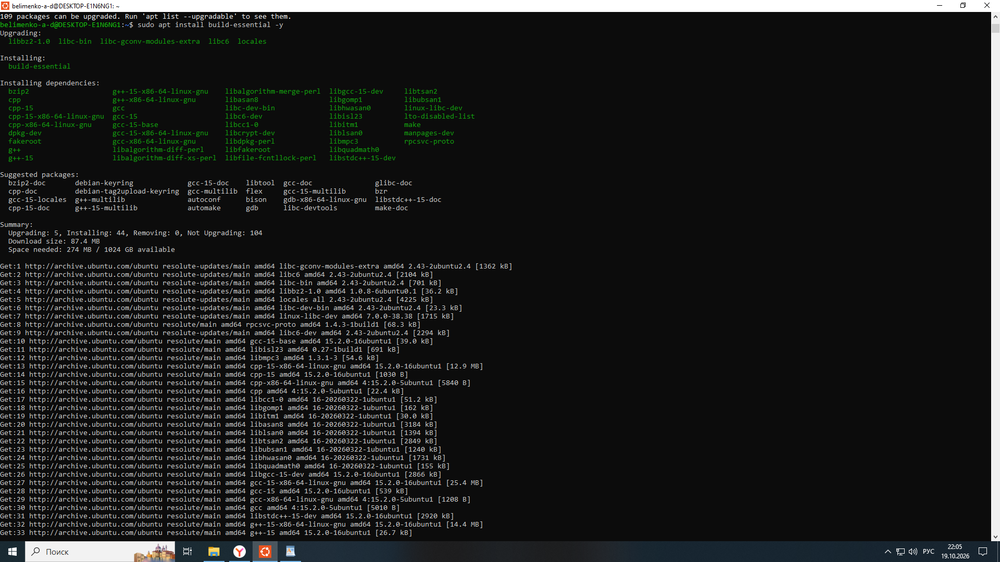
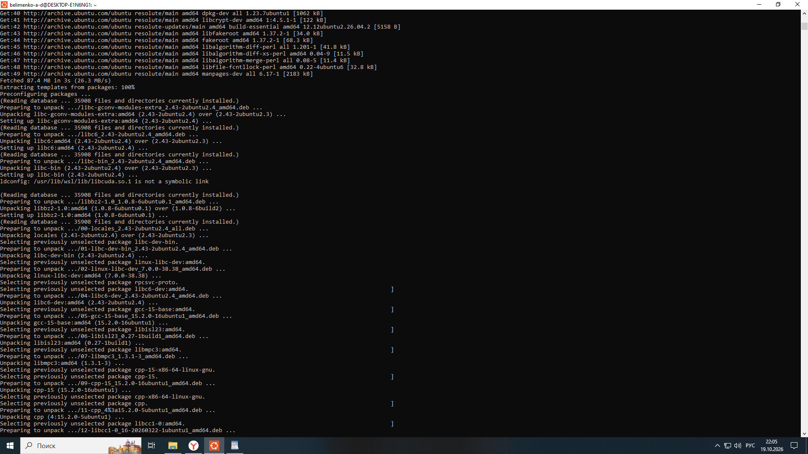
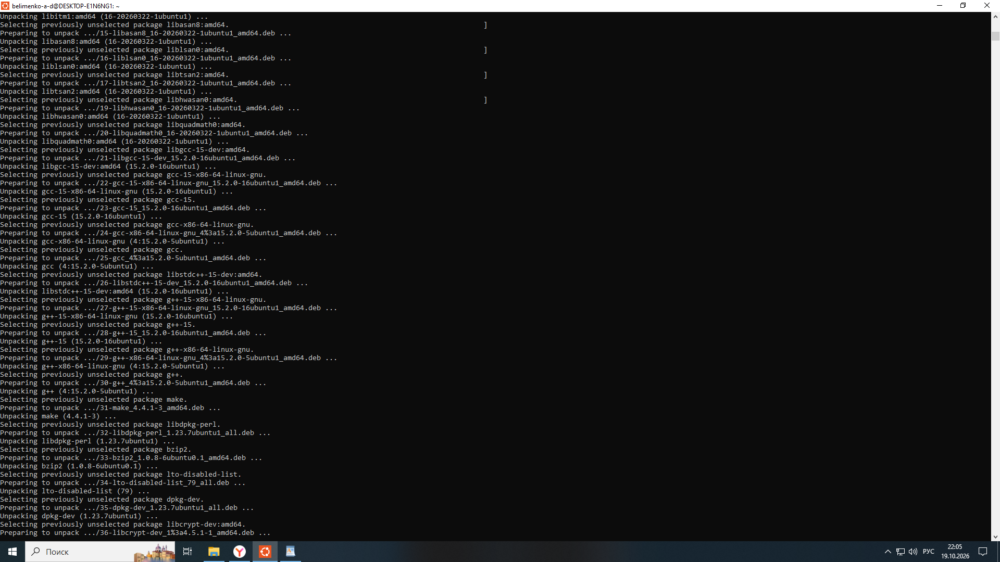
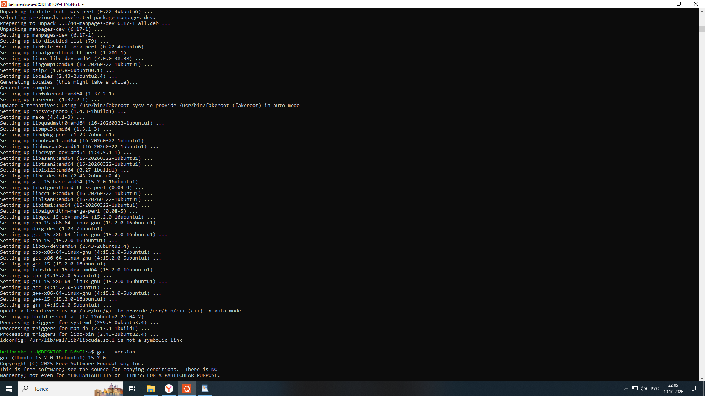
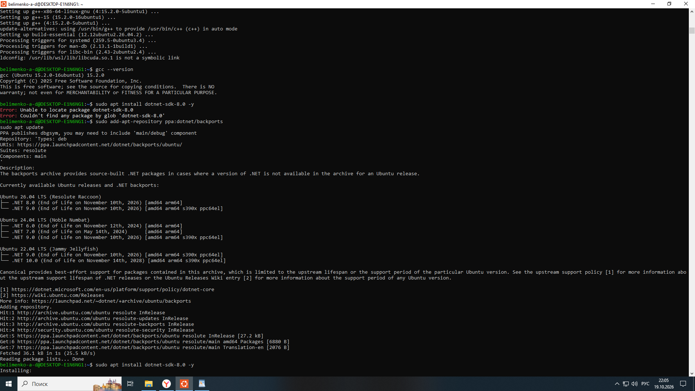

# Отчет по развертыванию окружения WSL

**Студент:** Белименко А. Д.
**Дата:** 19.10.2026

## 1. Установка WSL и Ubuntu
Выполнена установка подсистемы WSL и дистрибутива Ubuntu. Создан пользователь `belimenko-a-d`.

## 2. Установка компилятора GCC
Установлен пакет build-essential (включает GCC). Проверка версии:

## 3. Установка .NET SDK
Установлен .NET SDK 8.0. Проверка:

## 4. Установка PostgreSQL
Установлена СУБД PostgreSQL. Проверка статуса сервиса (active/running):

Проверка версии СУБД:

